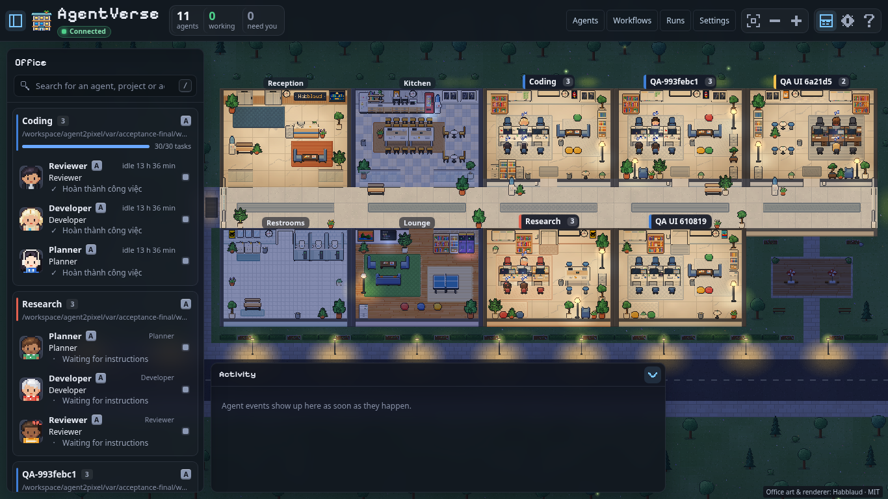
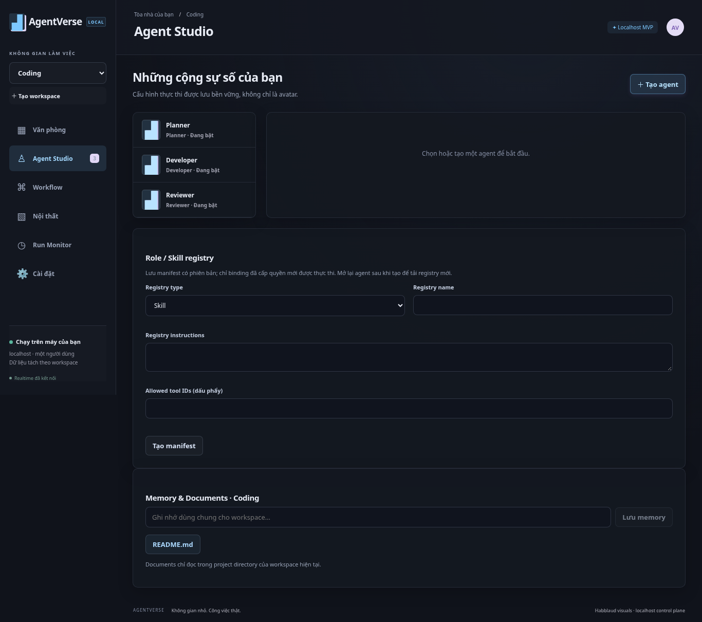
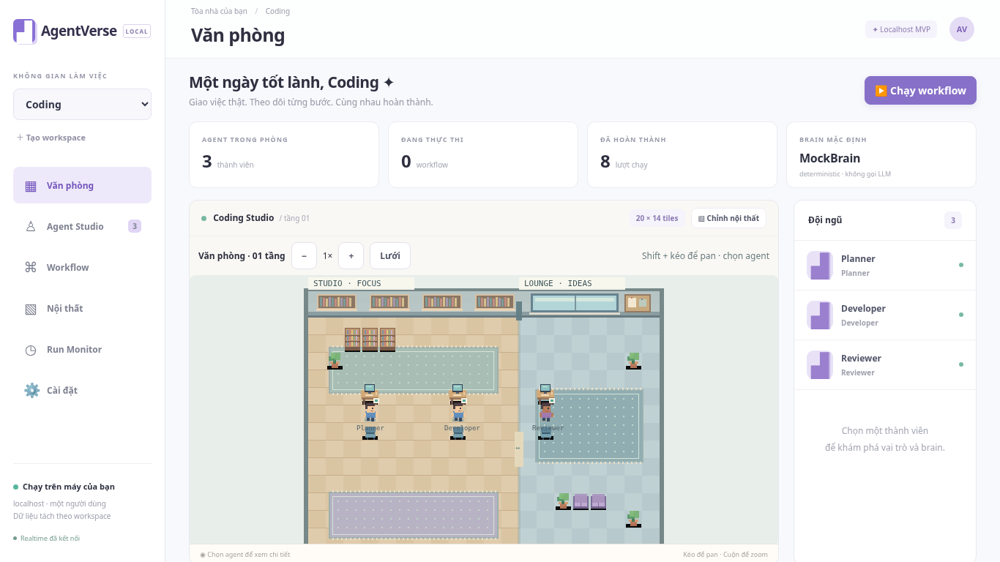
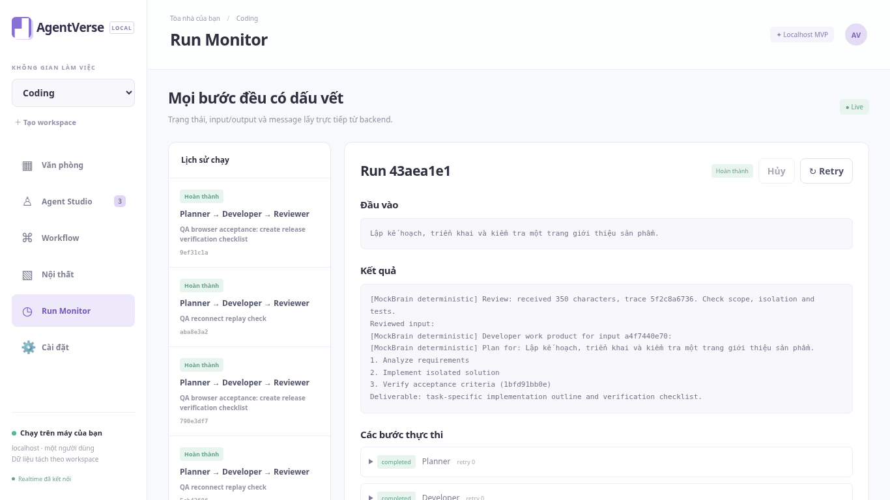

# AgentVerse — localhost MVP

Văn phòng pixel cho agent thực thi workflow có lưu lịch sử. Phạm vi: một người dùng trên localhost, một tòa nhà, hai workspace độc lập; không SaaS/thành phố. Requirement gốc: [v0.1](docs/requirements/AGENTVERSE_REQUIREMENTS_v0.1.md).

## Chạy development

Cần Python 3.12+, Node 24 và npm. Từ thư mục repository:

```sh
cp .env.example .env
bash scripts/install.sh
python3 scripts/dev.py
```

Mở localhost port 3000 trong trình duyệt. API port 8000; tất cả port dev bind 127.0.0.1. Office Habblaud port 3000, trang cấu hình `/control/` được proxy đến port 3001. Ctrl-C dừng cả ba service. Dùng `python3 scripts/dev.py --legacy` để chạy giao diện v0.1. SQLite và workspace files trong `var/`, bị Git bỏ qua. Không xóa `var/` nếu muốn giữ dữ liệu. MockBrain không cần key hoặc model. Nó thực thi workflow thật với output deterministic; không được hiểu là model AI bên ngoài đã được gọi.

## Công ty agent đa nhiệm — Phase 3

Định hướng mới: giao công việc đa dạng cho đội ngũ agent, không chỉ lập trình. [Kế hoạch](docs/plans/PHASE_3_COMPANY_WORKSPACE.md) mô tả Work board, brief/tiêu chí nghiệm thu, flow có hướng dẫn riêng từng bước, sản phẩm tài liệu và human review. Work board ở `/control/#workboard`, có nút mở từ office. Bằng chứng nghiệm thu Phase3 được ghi riêng, không suy từ test Phase2.

Research, nội dung, vận hành và coding là các mẫu flow chỉnh được. Khả năng làm việc thực tế phụ thuộc model, nguồn dữ liệu và tool được cấp. Template không tự tạo quyền tìm web, gửi email hoặc đăng bài. Không tự nhận hỗ trợ mọi task khi tool tương ứng chưa có.

Để giao việc: mở **Công việc**, nhập brief/tiêu chí và chọn workflow. Trong **Workflow**, dùng template hoặc kéo nối node, chọn agent, thêm hướng dẫn và tên file bàn giao `.md/.txt/.json/.csv`. Cấp `artifacts.write_text` trong Agent Studio nếu cần xuất file. Chạy việc → xem output thực tế trong Run Monitor → duyệt đúng nội dung trước khi lưu → quay lại Work board để nghiệm thu hoặc yêu cầu sửa. Sửa brief tạo revision mới và yêu cầu bằng chứng chạy mới.

## Nền tảng Phase 2

Tái sử dụng renderer, giao diện và đồ họa procedural Canvas2D Habblaud theo MIT; giữ nguyên attribution và font OFL trong `vendor/habblaud/`. Agent có role, skill, tool grants, memory và execution engine riêng. LangGraph lưu checkpoint SQLite; DeepSeek Harness dùng SDK/runtime chính thức và Cordis bridge giới hạn quyền. [Phạm vi và bằng chứng Phase 2](docs/PHASE_2_VALIDATION.md).

## Docker Compose

```sh
docker compose up --build
```

Port publish chỉ trên 127.0.0.1; API trong container nghe trên mạng nội bộ Compose. Dữ liệu lưu volume `agentverse-data`. Web proxy `/api`, `/health`, `/ws` đến API. Compose validation/build/runtime status xem báo cáo evidence, không suy từ sự tồn tại của Dockerfile.

## Workflow demo

Chọn Coding hoặc Research. Chọn ba agent Planner/Developer/Reviewer, dùng MockBrain mặc định; chỉnh role, provider và skin trong Agent Studio. Mở Workflow Builder, kiểm tra graph Start → Planner → Developer → Reviewer → End, lưu rồi chạy với yêu cầu của bạn. Run Monitor hiển thị task inputs/outputs, message handoffs và event sequence. Output từng node trở thành input node tiếp theo. Chạy lại, hủy hoặc retry thông qua backend. State văn phòng phản ánh backend events. Mất kết nối hiển thị disconnected.

Office có chọn agent và chế độ sửa furniture; lưu layout qua API, refresh để xác minh persistence. Các room/workspace có agent, task, memory và project root riêng.

## Provider và an toàn

Không lưu key trong form/DB/Git. Thiết lập credential bằng biến môi trường được mô tả trong `.env.example`; cấu hình provider/model/endpoint trong Agent Studio. Settings kiểm tra khả dụng. API adapter có test HTTP mock cho OpenAI-compatible và Ollama; thành công với mock không chứng minh tài khoản/API/model thật hoạt động. Không có key vẫn dùng MockBrain được. Không gửi secret trong chat hoặc AI logs.

Shell và tool có side effect bị chặn mặc định. Không có auth: giữ bind loopback, không mở public/tunnel. Workspace file reader kiểm tra containment/traversal/symlink; API và UI không cung cấp shell tùy ý. SQLite là lựa chọn prototype với migration schema versioned.

## Kiểm thử

```sh
.venv/bin/python -m pytest tests/backend tests/phase2/runtime tests/phase3/runtime tests/harness tests/projection tests/office_layout -q
npm --prefix apps/web test
npm --prefix apps/web run build
```

QA E2E và ảnh chụp: xem [hướng dẫn](tests/e2e/README.md), [review độc lập APPROVE](AI_LOGS/reviews/QA-001-review.md) và `tests/e2e/evidence/`. Kết quả chính xác, SHA được review và các giới hạn được ghi trong `docs/VALIDATION.md`; không coi checklist yêu cầu là kết quả test.

## Nguồn tham khảo và cộng tác

- [Reuse audit](docs/reuse/REUSE_AUDIT.md): commit, source, license và quyết định inspiration-only cho sáu repo + ChatDev legacy.
- [Visual board](docs/references/VISUAL_REFERENCE_BOARD.md) và [audit Phase 2](docs/reuse/HABBLAUD_PHASE2_REUSE_PLAN.md): v0.1 dùng artwork mới; Phase 2 dùng source và artwork Habblaud có license.
- [Contracts](docs/contracts/API.md), [ownership/task board](TASKS.md), [agent rules](AGENTS.md), [AI logs](AI_LOGS/INDEX.md).

Mỗi coding agent dùng branch/worktree riêng; một writer mỗi path. QA review độc lập, không tự sửa file owner khác. Không task nào DONE nếu thiếu commit, tests, session log, reviewer approval và integrator verification.

## Ảnh Phase 2 localhost





## Ảnh v0.1 trước đây

Ảnh chụp ứng dụng thực tế với MockBrain.





Review code: `services/api/`, `services/worker/`, `apps/web/src/`, `tests/`. Bằng chứng và giới hạn: [VALIDATION](docs/VALIDATION.md); [review độc lập](AI_LOGS/reviews/QA-001-review.md).
