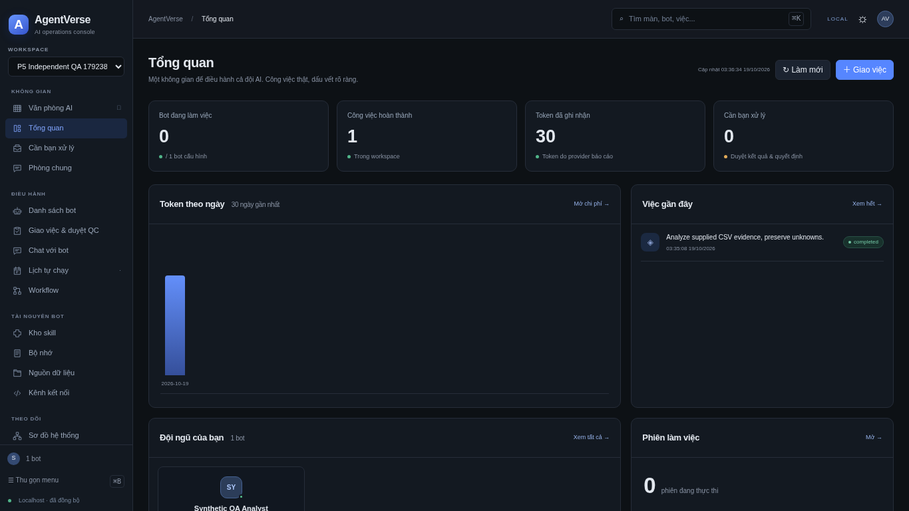

# Phase 5 — AI Operations Console: reviewed local core

**Integrated local core; full Phase5 remains OPEN.** Independently approved application SHA: `e9f5465756ad1ed6607d2fc8c032ef3387c43812`. [Independent review](../AI_LOGS/reviews/P5-FINAL-review.md), [QA contribution review](../AI_LOGS/reviews/P5-INT-review.md), [checks](../tests/phase5/evidence/e9f5465/checks.json). Later commits contain evidence/docs/test helper only; they do not extend the application approval.

Console follows the video's dark sidebar/header/cards and operating views using original code; CRM deferred. Real chat creates work/run in the existing LangGraph/Harness runtime. Office keeps actual Habblaud2D art/renderer and MIT/OFL notices. No private video frames/logo/account data copied, no dependency/framework added. [Requirementv0.5](requirements/AGENTVERSE_REQUIREMENTS_v0.5.md), [contract](contracts/phase5/IMPLEMENTATION.md), [referenceboard](references/VIDEO_CONSOLE_REFERENCE_BOARD.md).

## Results

| Check | Actual outcome |
|---|---|
| Python aggregate, including migration/security/skills/revisions/PNG/backup | **202PASS**,0failed/0skipped;114.37s; existing AnyIO deprecation warning |
| Control frontend | **73PASS**, build/lintPASS; mainchunk~529kB warning retained |
| Habblaud office | **14PASS**, type/buildPASS; final office source unchanged from reviewed owner commit |
| Legacy tile/state checks | **4PASS** |
| Actual HTTP workflow | PASS chat→CSVtool→artifact→payloadapproval→QC→humanaccept; scoped duplicates/foreign references rejected |
| Actual browser | PASS history/palette/theme/download/disconnect-retry, botA→B routing, configrollback/SOULhistory, topologycontrols/grantsunchanged |
| Process restart | PASS stablemessage/run/work/gateIDs, unchangedartifacthashes, deduplication and resumedQC/accept |
| Media / office / lighttheme | PASS actualPNGdecodedpreview/hash/context; foreignpreviewdenied; nonfixtureoffice→actualagentprofile; lightlabelcontrast13.07:1 |
| Screenshots | **54** darkscreens=18routes×3viewports; allhashes/dimensions/nonblank validated, independentcontactsheetreview and representativefull-size inspection |
| Stopped-data backup/restore | PASS16files verified, roots relocated, originaldata retained; QA independently6backup tests +WAL mutation/symlink guard probe |
| Fresh Docker build | **FAILED** DNS/proxy; outside-sandbox retry alsofailed, TLSverification preserved |
| Cached-dependency code image build | Built using prior images after confirming exact3lockfilehashes; not freshdependency verification |
| Cached-container runtime attempt | **FAILED** daemonstoragefull, no testcontainercreated; never countedPASS |
| Live inference / STT | **UNRUN**; keys absent, browservoice mocked only; no paid/live claim |
| Public web | **FAILED** DNS both normal and outside sandbox |

Full command/count provenance: [checks.json](../tests/phase5/evidence/e9f5465/checks.json). [HTTP](../tests/phase5/evidence/e9f5465/http/console-acceptance.json), [browser](../tests/phase5/evidence/e9f5465/browser/browser-behaviors.json), [regressions](../tests/phase5/evidence/e9f5465/regressions/browser-regressions.json), [actualrestart](../tests/phase5/evidence/e9f5465/restart.json), [PNG/office/contrast](../tests/phase5/evidence/e9f5465/media-office/visual-media-office.json), [54-screenmanifest](../tests/phase5/evidence/e9f5465/screens/screenshots.json), [all63imagehashes](../tests/phase5/evidence/e9f5465/evidence-index.json). All data synthetic; loopback provider fixture/MockBrain is labeled, while workflow/tools/store/browser are real.

## All19 requirements retained

“Local verified” covers the stated behavior, not every sentence of the original ID.

| ID | Local implementation / evidence | Remaining scope |
|---|---|---|
| P5-01 | Shell/nav/routepalette/keyboard/responsive/disconnect; browser+54screens | Exactvisual/userapproval, exhaustivea11y, globalentitysearch beyondroutepalette |
| P5-02 | Realoverview/activity/service counts; HTTP+screens | Remote facts/billing remainunknown |
| P5-03 | Distinct approval/QC/accept; HTTP | Broaderoperationalwarninginbox aggregation partial |
| P5-04 | Durable room→run, dedupe/cancel/lifecycleWSreplay; HTTP/browser/restart | Lifecycle events are not modeltokenstream; fullconversationcontext/roomparity notcertified |
| P5-05 | Correct boundagent and durable directhistory; actualA→B browser test | LiveproviderUNRUN |
| P5-06 | Botmetadata/SOUL/configdiff/history/rollback; actualbrowser test | Fullprofileusage/activity presentation partial |
| P5-07 | Work/queue/QC/archive/search, existingbackend+frontend regressions | No universalautonomouscompany execution claim |
| P5-08 | Editable flow/tool/hashedartifact/review; actualDecimalCSV | No inventedXLSX or liveadsconnector |
| P5-09 | Monitor-onlyscreen, honestunconfiguredcapability | ActualscheduleobservationadapterOPEN; no cronCRUD |
| P5-10 | Exactpreview localdeclarativeskill install/update/rollback/remove; backendtests | CheckboxbatchparityOPEN; arbitraryexecutableinstallersunsupported |
| P5-11 | Memoryscope/history/tombstones/provenance, consoleCAS2tests | Logicaldocumentpresentationpartial; legacyunversionedclientsnotCASprotected |
| P5-12 | Actualcapability/secret-name/service projection | Outboundchannels/gatewayintegrationsunconfigured/unverified |
| P5-13 | Registrytopology, actualsearch/zoom/fit/detail/rearrange | User/channel/task/servicegraphcoveragepartial |
| P5-14 | Usageperiod/provenance/budgetrevision/alerts; mixedestimated-provider tests | Split/cacheusage/pricing/actualbillingunavailable |
| P5-15 | Run-derived sessions and links | Exhaustivetime/statusfilterparitypartial |
| P5-16 | Separate bounded/redacteddiagnostics/audit/export; actualdownload | Fulltime/correlation/diagnosticfiltersOPEN |
| P5-17 | Persistedpreferences, repairedlightcontrast, lifecycleindependentrefresh | Exhaustivebrowser/a11y combinationsnotcertified |
| P5-18 | RealHabblaud snapshot/canvas/agentbridge; actualnonfixturebrowser | Freshcontaineracceptanceblocked; exactowner visualsignoffpending |
| P5-19 | Text/CSV/Markdown+strictboundedRGB/RGBAPNGpreview/metadata, optionalbrowservoicedraft | Generalimageformats/visionOCRunsupported; liveSTTUNRUN |

## Review fixes and operational limits

Four independent MAJOR findings were fixed and actually retested: logexport limit500→200, current-versus-prior revision rollback/diff, directbot selection preserving oldconversation, and estimated/provider tokenprovenance. The fullsuite settingsdraft race and emptychart styling were fixed; light typography now overrides legacy global colors. No failure was suppressed.

Workspace disk became full during verification. User aborted proposed image pruning; that prune was **not performed**. Original `/workspace/agent2pixel` and data remain; final changes/evidence were preserved in `/tmp/agentverse-p5-final` and published to GitHub reviewbranch `phase-5/ai-operations-console`. Final stack runs from the temporary checkout using restored `/tmp/agentverse-p5-restored-data`; this temporary location is not a fresh-environment restoration guarantee. Original checkout remains at82cc0d8 because its filesystem cannot accept final updates. No existing container/volume or user data was deleted. Own temporary cache-image tags and empty testnetwork were removed; these do not establish container acceptance.

During actual stopped backup, opening a WAL database read-only created readerSHM/emptyWAL sidecars and triggered a false “source changed” failure. Fixed fingerprint ignores readerSHM/emptyWAL only; nonemptyWAL/journal hashes, durable files, data_version, size and symlink guards remain. Regressions and actual16-file backup/restore passed. This is distinct from the disk/DNS failures.

Use the GitHub reviewbranch in a checkout with free disk, then `bash scripts/install.sh` and `python3 scripts/dev.py`: console3000, API8000, officevia`/office/`→internal3002, legacy`/control/`redirect. `--legacy` uses originalApp via explicitenvironmentflag. No SaaS/public deployment or mainmerge. Full Phase5 must remainOPEN until localparity backlog and required live integrations/visualapproval are resolved. Startupinstructions were saved as configurationdraft; saving does not repairdisk/DNS or publish/verify a new environment.
