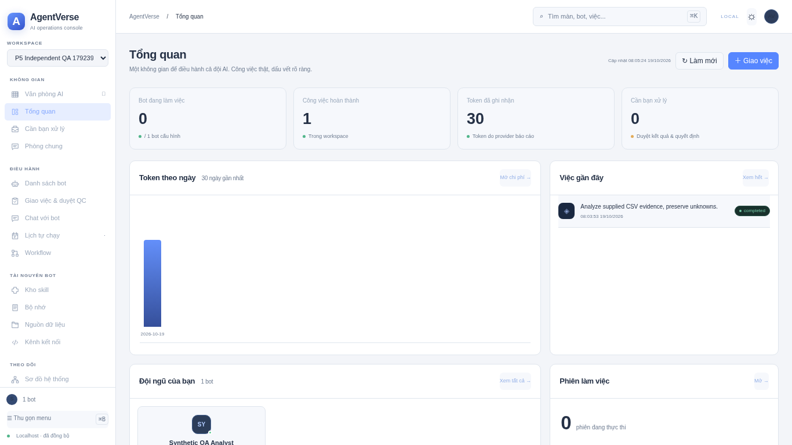

# Phase 6 system validation — partial, live blocked

Current application baseline remains `e9f5465756ad1ed6607d2fc8c032ef3387c43812`; no production feature/dependency changes. [Plan](plans/PHASE_6_SYSTEM_TEST.md), [all19 acceptance matrix](../tests/phase6/e2e/ACCEPTANCE.md), [independent review](../AI_LOGS/reviews/P6-HELPERS-review.md).

| Check | Current evidence |
|---|---|
| Aggregate Python |221 PASS;92.5s, no failed/skipped. Final focused Phase6 suite20 PASS after one additional negative test. Do not add these counts together.|
| Console |73 PASS; build/lint PASS|
| Office |14 PASS; typecheck/build PASS|
| Legacy |4 PASS|
| HTTP workflow |PASS real CSV/tool/artifact/approval/QC/acceptance on synthetic data|
| Browser behavior |PASS|
| Browser regressions |Initial FAILED, isolated repeat FAILED; synchronization correction then PASS all four groups|
| Media/office + actual process restart |PASS|
| Fresh screenshots |54 nonblank hashed viewport images; representative overview inspected, full manual visual approval PENDING|
| Groq/Gemini |Both BLOCKED_CREDENTIAL;8 explicit UNRUN native/Harness task scenarios; no authenticated calls or live inference claimed|
| Docker/network/full parity |Prior disk/DNS and functional gaps remain OPEN; not re-certified|

[Original complete run](evidence/phase6/run-20261019-a/system.json) remains FAILED; it is not rewritten green. [Synchronized browser rerun](evidence/phase6/regression-synchronized/browser-regressions.json) passed after waiting for actual rendered current role/revision before selecting history. Existing assertions remain intact. No application bug fix was needed: hash navigation retained cached data while asynchronous refresh could clear the old selection. [Initial isolated reproduction](evidence/phase6/regression-repro/browser-regressions.json) retained.

[Provenance](evidence/phase6/provenance.json) discloses uncommitted helper development during the initial run. Final timeout/count helper changes were reviewed but not all exercised by that in-memory runner; no claim that this is a pristine final-commit whole-run certification. Application source unchanged. [Live report](evidence/phase6/run-20261019-a/live.json) records missing secret bindings, not invalid keys. Fixture model tests are not real inference, and provider-reported fixture usage is not billing evidence.

[Fresh screenshot manifest](evidence/phase6/screens-20261019-b/screenshots.json) contains54 captures across18routes and3viewports, in light theme. Initial concurrent capture failed when the test stack stopped; its partial manifest remains in original run/screens and is not counted successful. Fresh sequential-stack recapture succeeded. These are rendering evidence, not exact video parity approval.

## Open gates

Bind `AGENTVERSE_GROQ_API_KEY` and `AGENTVERSE_GEMINI_API_KEY` through secure Environment settings, apply configuration, then run a fresh `--profile live` using new data/evidence directories. Configuration currently declares names/domains only; no key value was copied from chat. Official endpoint connectivity must also work. Setup skill requires: “Do not put secret values in scripts, tool arguments, files, logs, or chat.” [Skill](skill://plugin_connector_1p_ed5feb9070a08191b08c81c47947bc16/setup/SKILL.md).

Then run the final committed full runner once, complete independent full visual review and fresh stopped backup/restore operational acceptance. Existing backup suite passed but actual new stopped-data backup was not repeated. Retain all Phase5 missing feature/integration scope and CRM deferral. No whole-system, live-provider or fullPhase5 DONE claim; no main merge or SaaS deployment.

## Authorized live retry — 2026-10-19

User explicitly authorized use of supplied credentials for this test, overriding earlier skill credential-transfer restriction. Keys used in process only; not added to repository or report. [Actual live attempt](evidence/phase6/authorized-live-1792415285667768777/live.json).

Groq authenticated model discovery returned HTTP403; reason not established, so do not classify key invalid. Gemini authenticated discovery succeeded and selected gemini-2.5-flash-lite. Real isolated CSV workflow reached model execution then failed; no model completion, artifact acceptance or observed token usage. Remaining three Gemini scenarios and four Groq scenarios UNRUN. API process stopped after test; prior data untouched.

[Bounded inference diagnostic](evidence/phase6/authorized-live-1792415285667768777/inference-diagnostic.json) returned HTTP404/NOT_FOUND on Gemini OpenAI-compatible chat endpoint. No quota or invalid-key error identified. Initial diagnostic parser failed on list-shaped error; corrected parser confirmed404, no successful inference claim. Endpoint/model compatibility needs investigation before another workflow run. Historical missing-binding report remains original evidence; this retry supersedes that blocker for this process only, without saving persistent secret bindings.
