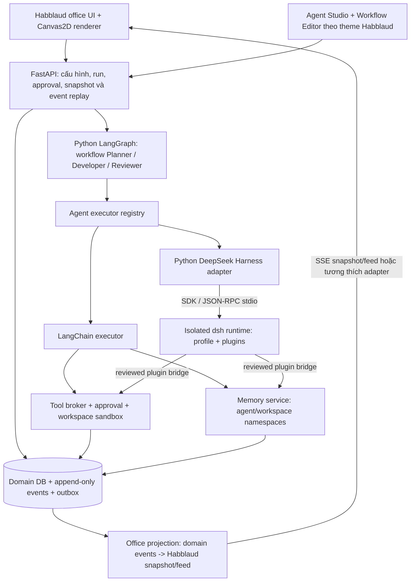

# Phase 2 — Habblaud-native visuals + Python agent runtime + DeepSeek Harness

Trạng thái: **PROPOSED — kế hoạch để review, chưa triển khai**. Ngày: 2026-10-17. Baseline AgentVerse: `230fbf2825a7c733daf6f383c398646248e70fb4`. Không thay đổi ứng dụng đang chạy hoặc nhánh main trong task lập kế hoạch này.

## 1. Mục tiêu đã điều chỉnh theo yêu cầu mới

Giao diện phải sử dụng trực tiếp phần đồ họa/renderer Habblaud được phép tái sử dụng: cùng nhân vật chibi, vật liệu sàn/tường, bàn ghế, đồ trang trí, bố cục phòng/hành lang, ánh sáng, chuyển động và UI office. Không tiếp tục lấy các hình chữ nhật Pixi đơn giản rồi gọi là tương đương Habblaud.

Sự khác biệt sản phẩm nằm ở agent thực thi: mỗi agent có Identity, Role, Brain, Skills, Tools, Memory, policy và Skin; workflow điều phối bởi Python, có lưu trạng thái, tool result, artifact và review thật. DeepSeek Harness tại https://github.com/deepseek-ai/deepseek-harness là executor plugin-capable cần tích hợp, không được nhầm với riêng model DeepSeek.

Yêu cầu mới thay thế lựa chọn “inspiration-only + procedural art viết mới” và light dashboard của v0.1 **cho phase 2**. Audit, screenshot và verdict v0.1 vẫn là lịch sử của bản cũ, không phải bằng chứng visual phase 2 đạt yêu cầu.

Giữ localhost, một người dùng, một tòa nhà/một tầng, hai workspace Coding/Research. Có thể giữ phần ngoại cảnh trang trí của office reference để đúng hình; không triển khai city navigation, multiplayer, social network, nhiều tòa nhà, SaaS hoặc cloud runner.

## 2. Kết quả khảo sát và quyết định công nghệ

| Thành phần | Quyết định phase 2 | Bằng chứng / giới hạn |
|---|---|---|
| Habblaud graphics | Tái sử dụng code Canvas2D upstream, không port lại sang Pixi | SHA `faa1a012b5fbf632c66dc6801c5383e53a542406`; MIT; `client/src/art/api.ts` TILE=16, character renderer24×34, source furniture/floor/wall/rig/pose thật |
| Habblaud UI | Adopt office shell, roster, topbar, feed và character editor; thêm panel agent cấu hình | Upstream không phải React app; cần host/island integration, không mặc định copy component vào React |
| Team workflow | LangGraph Python | Durable graph/checkpoint/interrupt; là orchestrator duy nhất của team |
| Model và Python tools | LangChain core/provider packages | Chỉ dùng component cần thiết; registry/tool policy thuộc AgentVerse |
| DeepSeek Harness | Executor tùy chọn theo agent nhưng là deliverable bắt buộc của phase 2 | MIT, developer preview. Python SDK chính thức gọi bundled runtime bằng JSON-RPC stdio; runtime không phải Python thuần |
| CrewAI | Phương án thay thế, không thêm vào stack mặc định | Không chạy CrewAI và LangGraph cùng sở hữu một team workflow; chỉ đổi nếu spike có bằng chứng LangGraph không đáp ứng |
| DeepSeek model | Brain provider độc lập | Có thể dùng qua LangChain adapter hoặc Harness provider; không đồng nghĩa với Harness |
| Persistence | SQLite + migration + LangGraph SQLite checkpoints + Harness session store riêng | Checkpoint không thay thế domain DB/event log; không dual-write mù quáng |

Không cài framework hay chạy source upstream trong task này. License/PyPI metadata và các điểm API/source đã được đọc; tương thích runtime/build **chưa được test**. Danh sách nguồn/pin ở tài liệu reuse đi kèm.

## 3. Kiến trúc đề xuất

FastAPI là control plane của app; worker chịu trách nhiệm model/tool/subprocess. Không đưa shell vào route API. Browser không truy cập dsh trực tiếp và không mở thêm Web UI3080. Habblaud Node transcript-watching server không được mang sang làm runtime agent thứ hai.

### Phân quyền điều phối

- **LangGraph**: team DAG, chọn agent tiếp theo, condition, approval node, checkpoint, retry team và kết thúc run.
- **Executor**: thực hiện một assignment của một agent; trả typed events/result. Harness sở hữu agent/tool loop bên trong assignment của nó; native executor sở hữu loop tương ứng của nó. Không bọc cùng task bằng hai agent loops.
- **Policy broker**: quyết định quyền và budget cho mọi tool, kể cả tool từ Harness. Nếu chưa kiểm soát được một tool surface, tool đó không được bật.
- **Database**: trạng thái nghiệp vụ/events đã commit là nguồn sự thật. LangGraph checkpoint và Harness JSONL là state của engine, không được tự suy thành workflow.completed.
- **Renderer**: vị trí, animation, camera; không được tự hoàn thành task, tự tạo agent message hoặc báo provider thành công.

## 4. AgentSpec phải có hành vi thật

Các field dưới đây là schema thiết kế đề xuất, chưa phải API đã tồn tại:

| Nhóm | Field / dữ liệu | Hành vi cần kiểm chứng |
|---|---|---|
| Identity | immutable id, workspace_id, name, enabled | Không đổi workspace qua PATCH; vô hiệu hóa chặn assignment mới |
| Role | role_id, version, system instructions, responsibilities, output_schema | Prompt role được dùng thật; kiểm tra schema output trước handoff |
| Brain | provider, model, endpoint ref, secret_ref, reasoning config/capabilities | Chỉ cấu hình được capability đã kiểm chứng; key không nằm trong DB/response |
| Execution | engine=`langchain` hoặc `deepseek_harness`, profile_ref, engine_version | UI kiểm tra engine sẵn sàng; lỗi thiếu runtime không âm thầm fallback MockBrain |
| Skills | skill_id, version, manifest hash, instructions, declared tools, resources | Load manifest/body vào execution context, ghi activation event; skill không được tự cấp quyền tool |
| Tools | registered tool_id/version, input/output JSON Schema, grants | Registry dispatch thật, result typed, policy check tại thời điểm gọi; không chỉ là string trong form |
| Memory | policy, namespace, retention, allowed scopes | Short-term/checkpoint và long-term riêng; read/write qua service, không đọc chéo workspace/agent |
| Workspace | project root, artifact root, allowed paths | Path containment, symlink escape checks và process/container boundary khi bật code tool |
| Skin | Habblaud seed/appearance parts + workstation/room | Dùng renderer upstream, skin không ảnh hưởng quyền thực thi |
| Limits | timeout, max model/tool steps, tokens/cost, max delegates | Cộng dồn mọi executor/subagent/retry, không reset budget khi đổi node |

Một cấu hình mẫu cần thực hiện được: Researcher dùng native LangChain + memory.read + documents.read; Developer dùng DeepSeek Harness với skill coding đã duyệt; Reviewer dùng engine/model khác, chỉ đọc artifact/test report. Hai agent không dùng chung DSH_HOME hoặc session một cách ngầm định.

Memory ban đầu: SQLite notes/artifact metadata + explicit query/filter; chưa cần vector DB/RAG nếu chưa có use case. Framework memory không được mặc định thu thập toàn bộ file cá nhân. Skill là package instructions/resources có version; Tool là callable có schema và quyền. Không được gắn tên skill/tool/memory vào UI rồi coi là đã tích hợp.

## 5. Habblaud visual adoption — ưu tiên đầu tiên

### Code dự kiến tái sử dụng

- `client/src/art/**`: PixelBuf, palette/shading, sprites/cache, character rigs/appearance, furniture, floor/wall/rug, icons, pixel fonts.
- Các closure cần thiết của `client/src/world/{render,layout,path,sim}/**`, camera/assets/input và `client/src/world/api.ts`. Phải lập import graph trước khi chốt danh sách; renderer không phải file độc lập có thể copy một mình.
- Office UI trong `client/src/ui/`: topbar, sidebar/drawer, feed, character editor, typography/layout; shared appearance/i18n/types tương ứng.
- PNG trong `client/public/assets/art/` và illustration: tái sử dụng theo inventory/license cụ thể. Giữ license/copyright upstream; không đổi thành CC0. Tên/nhãn sản phẩm AgentVerse tách khỏi attribution Habblaud.

Ưu tiên vendor một frontend office slice đủ import closure tại `vendor/habblaud/` cùng provenance/patch ledger. Host riêng `apps/office/`; UI React hiện tại giữ tạm ở legacy để migration/rollback. Agent Studio/Workflow Editor làm React islands hoặc route cùng theme; spike quyết định cách mount, không viết lại renderer bằng Pixi chỉ để giữ toàn bộ React.

Không cần copy full Node server, CLI install hooks, PTY terminal, remote world/city hay source watcher của upstream. Nếu frontend còn gọi endpoint của các tính năng này, phải tháo call path hoặc cung cấp response disabled rõ ràng; không chỉ giấu nút và để console404.

### Visual gates đo được

1. Dựng Habblaud gốc tại commit pin thành **reference fixture**, cùng viewport/browser/device-scale, seed, clock, camera, layout, characters và animation frame; đây là visual fixture, không phải bằng chứng agent thật.
2. Capture upstream/app theo cùng fixture; canvas sprite/furniture/floor/wall crop nguyên trạng phải pixel-identical khi chạy cùng môi trường. Full-scene screenshot chỉ mask phần động đã kê rõ (timestamp/name/brand/panel), không mask nhân vật, vật liệu hoặc mật độ nội thất. Ngưỡng image diff scene phải được ghi và review trước, không nới ngưỡng để pass.
3. Contact sheet đặt upstream / AgentVerse / diff cạnh nhau ở1366×768 và1920×1080, lưu file PNG trên nhánh GitHub để review trực tiếp. CI assert đủ cảnh và không console/network error.
4. Checklist: nhân vật24×34, tile16, pose4 hướng, desk/monitor detail, material shading, wall depth, corridor/doorway, room density, plants/art/windows, shadows/lighting, roster/feed/detail và pan/zoom/hit testing.
5. Chỉ sau visual gate mới cho phép nối backend/runtime. **Không coi “code chạy + test pass” là visual đạt.** QA độc lập và người dùng review board trước khi bỏ frontend cũ.

Cosmetic idle walking có thể giữ, nhưng social coins/conversation/task giả không được xuất hiện như hoạt động của agent thực. `?mock=1`/demo simulator chỉ ở fixture/test route; mode chạy thật không được tự chuyển mock khi mất kết nối.

## 6. DeepSeek Harness integration đã xác minh và phần còn phải spike

Source đã kiểm tra: `687f282e8625c6b8d11ff58211a90524be2e4317`. README, LICENSE, SAFETY, architecture, Python SDK README/api/client, SDK minimal profile, core skill registry và third-party notices. Upstream là developer preview có breaking changes; SDK source pin không đồng nghĩa published wheel có đủ cùng API.

### Điểm tích hợp có trong source

- Python SDK `DeepSeekHarness`, `Session.run()`, `resume_session()`, callbacks/notifications; SDK gọi `dsh --profile sdk` qua newline JSON-RPC stdio.
- `dsh_home` bắt buộc rõ ràng, cùng `cwd`, `profile`, ordered `patches`. SDK đồng bộ; không gọi blocking `run()` trên FastAPI event loop.
- Profile/bundle/plugin qua Cordis; default `sdk` và `sdk-minimal` có capability khác nhau. **sdk-minimal vẫn chứa persistent shell/local execution, không phải read-only sandbox an toàn mặc định.**
- `RunResult.finish_reason` phân biệt completed/max-tokens/error; agent idle/final text chưa đủ để báo thành công.
- SDK tự launch same-version bundled runtime; plugin management ngoài có thể cần pnpm. Python sử dụng runtime Node/native đã bundle, không phải thuần Python.

### Spike bắt buộc P2-02

1. Chọn cùng-version SDK/runtime có artifact chạy trên target (Python3.12/Linux x86_64 trước). PyPI lúc khảo sát có SDK/runtime `0.1.5rc1`, Linux wheel manylinux2_28; source manifest là dev version. Không tự thay checksum hoặc trộn release/source runtime.
2. Kiểm chứng profile/patches/SDK capabilities thật của release đã chọn; pin versions/hashes và contract test. Nếu cần source revision mới thì build theo quy trình upstream, giữ nguyên notices; không tuyên bố pip wheel cũ chứa API mới.
3. Tạo `HarnessExecutor` dùng process worker riêng, explicit timeout, home riêng theo workspace/agent, bounded process concurrency, sanitized environment (SDK source mặc định inherits parent environment). Không expose toàn bộ credential/dev HOME vào child. Cần tạo outer Python worker với allowlisted environment trước khi SDK launch: source SDK dùng os.environ.copy()+update, nên truyền env={} không tự loại biến kế thừa.
4. Plugin bundle `agentverse-harness-bridge`: role prompt, allowlisted skill provider, tool policy/broker seam, memory provider và event projection. Đây là code TS/Cordis mới, không giả định Python tool callable tự thành Harness plugin.
5. Một registry Skill/Tool/Memory của AgentVerse; cả native executor và Harness plugin bridge đọc cùng spec/grants. Không có kho quyền thứ hai tùy ý trong Harness.
6. Kiểm chứng cancel/interrupt/approval thật trong SDK hoặc protocol của version chọn. Không bịa `cancel()` nếu API không có. Nếu không có cooperative cancel, dừng đúng isolated process tree và đánh dấu interrupted/failed, cleanup con, không ảnh hưởng agent khác; không late success.
7. Gate shell/write/network/unknown tools từ upstream bằng capability policy và process/container sandbox riêng. Không chỉ thêm broker rồi để native tools đi đường vòng; kiểm thử cả native tool calls, PTC/run_code, subprocess và plugin tools. Dependency/plugin install là thay đổi được review, không tự `npx latest` trong runtime.
8. Map durable session events, subagent ancestry và tool results sang app event IDs; discard provider reasoning/private content khỏi AI dev logs/UI feed. Nội dung runtime cần thiết có access/retention riêng; không dump stderr/env/session raw vào AI_LOGS.
9. Test model-response stub, fake RPC transport lỗi, process crash/restart, duplicate/out-of-order notification, wrong session/workspace, permission bypass, token limit và cancellation. Một live DeepSeek smoke khi có binding hợp lệ; thiếu key thì ghi UNRUN, không đổi thành PASS nhờ mock.

“Plug-and-play” nghĩa có manifest/version/capability detection/install/uninstall/compatibility và rollback đã test. Không có nghĩa cài bất kỳ plugin Internet nào rồi cấp toàn quyền trên máy.

## 7. Event bridge và semantics

Domain contract v2 là canonical; office projection chuyển sang Habblaud `OfficeSnapshot`/feed. Có thể dùng SSE `/api/stream` và `/api/snapshot` tương thích frontend để giảm patch; REST domain vẫn ở `/api/*`. WS v1 giữ trong giai đoạn chuyển tiếp, cả hai từ cùng event store/outbox, không tạo hai nguồn sự thật.

| Domain event | Visual / behavior |
|---|---|
| agent.created/idle | persistent office character; seed/parts thật |
| task.queued | waiting/pending label, không giả typing |
| task.started/model/tool progress | working/type/read/use theo activity đã chuẩn hóa |
| approval.required | waiting/raise_hand với request ID thật |
| tool.completed | activity/result link; không coi là toàn workflow completed |
| task.completed | completion badge/activity; agent chính quay idle, không mặc định dùng Habblaud subagent done rồi rời office |
| task.failed | error activity/badge + status extension nếu cần; không map thành success/idle im lặng |
| task.cancelled | cancelled task; agent idle sau cleanup |
| disconnected | badge disconnected, snapshot giữ trạng thái cuối nhưng không kết thúc task |

Upstream `Provider` union đang là claude/codex; backend Python/DeepSeek không được gắn nhãn claude giả để ép typecheck. Adapter extension phải tách `execution_engine`, `brain_provider`, `source`, lineage và original status. UI usage không có số liệu phải hiện unknown/estimated, không lấy quota upstream giả.

Event envelope: event_id/schema_version/seq/workspace_id/run_id/task_id/agent_id/correlation_id, occurred_at, sanitized payload và source engine/engine_event_id. Inbox/outbox dedup index; monotonic app seq commit trước broadcast. Harness session store là engine source; app projector idempotent sau crash, có reconciliation về cùng run/session. Không hứa exactly-once cho external side effects; idempotency key và approval chỉ thực hiện trong sandbox, process loss có thể cần human reconciliation.

LangGraph checkpoint thread_id namespaced theo workspace/run. Resume chỉ khôi phục stage cần thiết, không chạy lại tool đã có artifact/result committed. Native và Harness đều theo chung retry ownership/budget. No arbitrary cycles; branch/retry được kiểm soát rõ.

## 8. Migration và giữ phần đã làm được

Giữ: workspace/agent IDs, history/run outputs, API CRUD và validators có giá trị, path/policy tests, tool dispatcher, event seq/replay, lock/concurrency fixes, QA safety regressions. Không reset DB để chuyển giao diện.

Thay: Pixi graphics/office mặc định và light dashboard; custom DAG scheduler bởi LangGraph adapter sau parity tests. React Flow editor có thể giữ như island cùng theme; không giữ CSS cũ làm lệch office shell.

Migrations có backup/rollback và schema_version; thêm role/skill/tool bindings/version, engine_config, memory namespace, checkpoint pointers, external session mapping, artifact/test result và approval records. Embedded v0.1 agent configs được chuyển có giữ IDs. Pin config/role/skill/tool versions tại thời điểm run để sửa Studio không thay assignment đang chạy. Không serialize secret values vào checkpoint/session graph state.

Rollout: tag/base commit v0.1, feature flags office_v2/runtime_v2/harness_engine, read-compatible API v1, chạy parity trên fixture DB copy; chuyển default sau gates. Có rollback code + migration/checkpoint compatibility; không âm thầm rollback DB làm mất lịch sử mới.

## 9. Các mốc và task độc lập

Các branch/worktree dưới đây là **đề xuất cho lúc triển khai**, chưa tạo trong task lập kế hoạch. Path giao cắt chỉ được sửa bởi Integrator sau handoff owner; schema đổi phải Architect cập nhật trước.

| Task | Owner / proposed branch | Owned paths | Dependencies | Acceptance gate |
|---|---|---|---|---|
| P2-00 baseline/license | Architect/Research `agent/architect/P2-00` | docs/reuse/, docs/references/phase2/, third-party inventory | none | source pin, file/hash/license/closure manifest, upstream reference captures; không claim source đã vendored |
| P2-01 Habblaud adoption | Pixel/Game `agent/pixel/P2-01` | vendor/habblaud/, packages/office-view/, apps/office/src/scene/ | P2-00 | nguyên renderer/appearance/furniture, same-fixture diff + visual board; chưa nối workflow |
| P2-02 Harness spike | Harness Integration `agent/harness/P2-02` | services/worker/executors/harness/, packages/harness-bridge/, tests/harness/ | P2-00 + contract draft | exact SDK/runtime version, plugins/read-only policy/cancel/session isolation tested; decision record GO/NO-GO |
| P2-03 AgentSpec v2 | Backend Domain `agent/backend/P2-03` | services/api/domain/, services/api/migrations/, services/api/v2/, tests/domain/ | Architect schema approval | full Role/Brain/Skills/Tools/Memory registry CRUD/version/permission + v1 migration/rollback |
| P2-04 LangGraph runtime | Backend Runtime `agent/runtime/P2-04` | services/worker/graphs/, services/worker/executors/native/, tests/runtime/ | P2-03 + executor contract | persisted graph, actual tools, checkpoint/restart/condition/retry/budget/approval/cancel parity |
| P2-05 office event adapter | Integrator/Bridge `agent/bridge/P2-05` | services/api/office_projection/, packages/office-adapter/, tests/contracts/ | P2-01 visual gate + P2-03/P2-04 | live domain state -> upstream snapshot/feed, exact new-event replay/dedup, no fake CLI/provider labels |
| P2-06 agent control UI | Frontend `agent/frontend/P2-06` | apps/office/src/studio/, apps/office/src/workflows/, apps/office/src/shell/ | P2-01 + P2-03 | Habblaud theme, create/configure Role/Brain/Skills/Tools/Memory/Skin, plugin capability/disabled reason visible |
| P2-07 Harness full integration | Harness Integration `agent/harness/P2-07` | same owner paths as P2-02 after it completes | P2-02 GO + P2-03/P2-04/P2-05 | real runtime notifications/tools/memory/skills, cross-engine workflow, per-agent plug/unplug/rollback; no permission bypass |
| P2-08 independent acceptance | QA `agent/qa/P2-08` | tests/phase2/, AI_LOGS/reviews/P2-*, screenshot evidence | each incremental handoff then final | independent visual + real tool/file/test artifacts + migration + security + exact replay; verdict pinned SHA |
| P2-09 integration/release | Integrator `agent/integrator/P2-09` | root startup/Compose/CI/docs + coordinated mount points | all prior gates | one-command localhost from clean install, live/demo labels, reviewer approval, user visual review, changelog/rollback |

Execution order: P2-00 → P2-01 **visual checkpoint first**. P2-02 research spike and P2-03 domain can run independently after contracts. P2-04 and P2-06 then integrate through P2-05; P2-07 uses verified Harness seam. QA reviews each milestone; final integration only after gates. Không đưa một agent làm cả renderer + runtime + self-review.

Mỗi task có AI session/handoff, exact source commit, owned_paths, tests PASS/FAIL/UNRUN, reuse status và reviewer decision. Một writer/file; mỗi coding agent dedicated branch/worktree theo protocol đã có. Không bắt đầu parallel implementation trước schema/ownership agreement. Plan/task completion không được gán DONE cho implementation chưa chạy.

## 10. Acceptance demo bắt buộc

1. **Visual parity:** mở office Habblaud-style tại localhost3000, hai workspace/two rooms, detailed assets gốc, real character selection/appearance, furniture edit/path collision, pan/zoom. Review contact sheet upstream/app/diff và video thao tác, không chỉ ảnh đẹp.
2. **Agent architecture thật:** tạo Planner, Developer, Reviewer; mỗi agent có Role/Skills/Tools/Memory/Brain riêng, thay engine theo capability; activation/tool/memory events có trace, không chỉ lưu string form.
3. **Mixed-engine workflow:** Planner(native) → Developer(Harness) → Reviewer(native hoặc Harness). Skill code-report đọc fixture; approved Developer tạo file Python nhỏ trong sandbox; tool chạy pytest allowlisted; Reviewer đọc file/test report và trả structured verdict. Artifact SHA/path, tool exit code, test count, input/output và handoff persist. Bản read-only có thể làm bước rehearsal nhưng không thay thế demo này khi tuyên bố coding tools hoàn thành.
4. **Failure paths:** forbidden path/network/shell bị chặn; approval denied/expired/reused/cross-workspace rejected; model/tool lỗi không giả completed; reviewer fail có bounded retry; in-flight cancellation không late success; process crash có explicit interrupted state.
5. **Durability:** refresh/restart giữ AgentSpec/layout/memory/history; reconnect nhận đúng event của newrun mới, không match một completion cũ. Giữ original IDs sau migration.
6. **Provider evidence:** mock transport/runtime tests chạy không key; ít nhất một Harness real-runtime smoke với provider stub hợp lệ nếu profile hỗ trợ; live model có key thì separate gated test. Không có key hoặc không có compatible runtime phải báo rõ UNRUN/BLOCKED cho phần đó; không gọi toàn bộ phase complete.
7. **Deliverable review:** screenshots mỗi màn hình1366×768 + office1920×1080, interaction video/Playwright, console/network clean, logs sanitized, reuse attribution/notices, independent source+visual APPROVE và Integrator verification. Assets/code đưa lên GitHub thật; không gửi link /tmp khó xem như bằng chứng review duy nhất.

## 11. Rủi ro và điều kiện quyết định

- Habblaud frontend tightly coupled shared types/world sim/UI; dùng import-closure spike và adapter seam, tránh copy một vài file rồi vẽ lại. Upstream test/toolchain pins phải kiểm chứng, không tự sửa lock để ép build.
- Reused MIT graphics giữ copyright; PNG license review theo từng file; branding và artwork attribution khác nhau. Bất kỳ exception chưa rõ phải block đúng file, không block cả procedural renderer đã MIT rõ.
- Harness preview/version drift/native wheel và third-party closure cần gate thật. `sdk-minimal` không read-only; integration không được tin sandbox upstream là toàn bộ boundary.
- Checkpoints + Harness logs + app outbox dễ lệch sau crash; require idempotent projection/reconciliation tests, single source of completion và artifact idempotency.
- Skills/plugins có thể chứa instructions không tin cậy; cài plugin chỉ từ explicit approved manifest, version pinned, effective grants không tăng qua skill text.
- Không cần thêm CrewAI/DeepAgents vào deliverable khi DeepSeek Harness đã là executor được yêu cầu. Nếu Harness không đáp ứng gate, ghi NO-GO và bằng chứng cụ thể; không âm thầm đổi framework rồi báo đã tích hợp Harness.

## 12. Definition of Ready cho bước code tiếp theo

Plan này, [reuse delta](../reuse/HABBLAUD_PHASE2_REUSE_PLAN.md) và [ADR](../../AI_LOGS/decisions/ADR-0004-phase2-habblaud-and-harness.md) là bộ tài liệu của nhánh review. Bước thực thi đầu tiên là P2-00/P2-01 để cung cấp **reference screenshot vs actual reused Habblaud graphics**, sau đó review visual trước khi mở rộng runtime. Contract JSON Schema v2, import closure/vendor manifest và SDK compatibility record là output bắt buộc của foundation tasks, không được tự gọi là đã tồn tại chỉ vì được mô tả trong plan.
